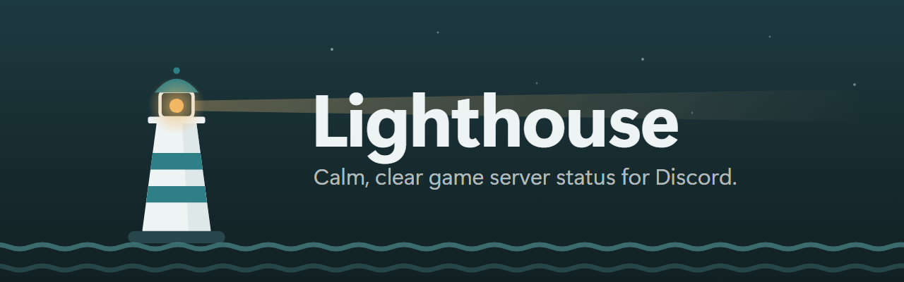

<p align="center"></p>

# Lighthouse

**Calm, clear game server status for Discord.**

Lighthouse watches your game servers and keeps a tidy status post for each one in a Discord channel,
updated in place: online or offline, players, time since the last restart, map, version, and (for
7 Days to Die) the in-game day and the next blood moon. The bot's status line rotates through your
servers, and it can post an alert when a server goes down or comes back.

An optional web dashboard adds uptime history, population reports, server logs, and accounts for
your admins.

> **Status:** early. It works and is tested against live servers; expect rough edges until 1.0.

## Contents

- [What you need](#what-you-need)
- [Quick start](#quick-start)
- [Where to run it](#where-to-run-it)
- [Everyday commands](#everyday-commands)
- [The web dashboard](#the-web-dashboard)
- [Updates](#updates)
- [Troubleshooting](#troubleshooting)
- [Supported games](#supported-games)
- [For developers](#for-developers)

## What you need

- A **Windows 10/11 or Linux** computer that stays on: a home PC, a small VPS, or the machine your
  game servers run on. Docker works too.
- A **Discord server** where you can manage channels.
- Each game server's **address and port**. No game mods are needed.

## Quick start

1. **Download** Lighthouse for your system from the
   [latest release](https://github.com/Hailey-Ross/hails.Lighthouse/releases/latest), put it in a
   folder of its own, and rename it:
   - **Windows:** `lighthouse-x86_64-pc-windows-msvc.exe` → `lighthouse.exe`
   - **Linux:** `lighthouse-x86_64-unknown-linux-gnu` → `lighthouse`, then make it runnable with
     `chmod +x lighthouse`
2. **Run the setup** in a terminal in the same folder: `lighthouse setup`
   (on Windows `.\lighthouse setup`). It walks you through everything:
   - **Your servers:** start typing the game's name to pick it, then the address, port and a
     display name. Lighthouse checks each server answers before moving on.
   - **Your Discord bot:** step by step through Discord's Developer Portal (what to click, which
     switches to leave off), checks your token, and gives you the link that adds the bot to your
     server with the right permissions.
   - **Optional extras:** the web dashboard, and automatic updates.
3. **Start it:** `lighthouse run`. Within about 30 seconds the bot posts the status board in your
   channel and keeps it up to date.

Prefer the browser? The first question of the setup offers a **quick setup** that only sets a
dashboard password.

The release page has more detailed steps for Windows, Linux (including running it as a background
service) and Docker.

## Where to run it

Lighthouse checks your servers over the network, the same way the in-game server browser does, so it
**does not have to run on the game server itself.** Any always-on computer that can reach your servers
works.

- **Rented or managed game servers** (where you only get a control panel and FTP): run Lighthouse on a
  home PC, a small VPS or any other machine. Nothing needs to be installed on the game server.
- **Your own server or a dedicated machine:** run it right there if you like. The dashboard can then
  also show the game servers' log files.
- **Firewalls:** Lighthouse needs to reach each server's **query port** over UDP (see
  [Troubleshooting](#a-server-shows-offline-but-people-are-playing)), and the internet for Discord. It
  never needs incoming connections; the dashboard only listens on the machine itself unless you change it.

## Everyday commands

| Command | What it does |
|---|---|
| `lighthouse setup` | First-time setup (or start over). |
| `lighthouse run` | Start Lighthouse. Stop it with Ctrl+C. |
| `lighthouse check-config` | Check `lighthouse.toml` for mistakes. |
| `lighthouse query <game> <address> [port]` | Ask one server for its status right now. Great for finding the right port. |
| `lighthouse games [name]` | List the supported games and their usual ports. |
| `lighthouse bot-mode per-game` / `mega` | Switch between one bot per game and one bot for all games (walks you through any new bots). |
| `lighthouse set-password` | Turn on the dashboard, or reset the superadmin password. |
| `lighthouse unblock <address>` | Lift a dashboard block (for example if you locked yourself out). |
| `lighthouse update` | Check for and install a new version. |
| `lighthouse --version` | Show the version, build and channel. |

Everything lives in `lighthouse.toml` next to the program, alongside a small database
(`lighthouse.db`) and `lighthouse.state.json`. Back these up to keep your settings, history and posts.
[`lighthouse.example.toml`](lighthouse.example.toml) explains every setting.

## The web dashboard

Off unless you turn it on (in the setup, or later with `lighthouse set-password`). Open
<http://127.0.0.1:8650> on the machine running Lighthouse and sign in.

- **Servers** at a glance, **Uptime** (history and outages), **Reports** (players over time, peaks,
  player-hours, when people play, CSV export), **Logs** (for game servers on the same machine: set
  `log_dir` on the server in `lighthouse.toml`), **Users** and **Security**.
- **Admins:** the superadmin from the setup invites others from the Users page and ticks exactly
  which pages and servers each one can see. Sign-up only works with an invite link; addresses that
  guess invite links are blocked for longer each time.
- **Reaching it from elsewhere:** put it behind a reverse proxy with HTTPS (Caddy or nginx), set
  `bind` to the address the proxy connects to, and turn on `trust_proxy` so blocks apply to visitors
  rather than to the proxy.
- Four colour themes, and it works on phones.

## Updates

Lighthouse checks this project's releases once a day. With `auto_install = true` under `[updates]` it
installs a new build and restarts by itself; otherwise it mentions it in the log, and
`lighthouse update` installs it. Pick a channel:

- **stable** (default): the latest working build.
- **bleeding-edge**: every change as it lands; it may break.

## Troubleshooting

#### A server shows offline but people are playing

Lighthouse is asking the wrong port, or a firewall is blocking it. Many games answer status questions
on a **query port** that differs from the port players join:

| Game | Query port |
|---|---|
| 7 Days to Die | the game port (default 26900) |
| Project Zomboid (B42) | `SteamPort1`, default **8766** (not 16261) |
| VEIN | usually the game port **+ 1** (or `-QueryPort`, default 27015) |
| Others | see [docs/games.md](docs/games.md); often the game port, game port + 1, or 27015 |

Try it: `lighthouse query pz 203.0.113.10 8766`. When you find the port that answers, put it in
`lighthouse.toml` as `query_port = …` on that server. Rented servers often list the query port in the
control panel's port section.

#### The bot doesn't post anything

- Run `lighthouse check-config`, then look at the log `lighthouse run` prints.
- "Cannot post in channel": give the bot **View Channel**, **Send Messages** and **Read Message
  History** in that channel (channel settings → Permissions).
- "Discord rejected the token": reset the token on the bot's page in the Developer Portal and paste the
  new one (run `lighthouse setup` again, or edit `lighthouse.toml`).

#### I can't open the dashboard

- Is it on? `lighthouse check-config` says "dashboard on" or "off".
- It only listens on the machine itself (`127.0.0.1:8650`) by default. From another computer, use a
  reverse proxy (see [The web dashboard](#the-web-dashboard)).
- "Access blocked": that address guessed invite links. Run `lighthouse unblock <address>` on the
  machine, or lift it on the Security page.

## Supported games

- **Full support** (tested on live servers): **7 Days to Die**, **Project Zomboid** (Build 42) and
  **VEIN**.
- **Experimental:** 100+ games that answer the Steam server query (Valheim, Rust, ARK, Counter-Strike 2,
  Conan Exiles, DayZ, Enshrouded, V Rising and many more), plus **Minecraft** Java and Bedrock, and
  **FiveM/RedM**. These should work; their default ports haven't all been checked yet.

Full list with ports: [docs/games.md](docs/games.md). 7 Days to Die and VEIN don't share player
names through the server query, so their cards show player counts only.

## For developers

```sh
cargo build --release
cargo test
```

Rust 1.85 or newer. Releases are built by GitHub Actions: pushes to `dev` publish the
**bleeding-edge** pre-release, pushes to `main` publish **stable** (and a permanent `vX.Y.Z` release
when the version in `Cargo.toml` is new; it needs a section in [CHANGELOG.md](CHANGELOG.md)).

| Path | What |
|---|---|
| `crates/lighthouse` | The `lighthouse` program: setup, updates, command line |
| `crates/lighthouse-core` | Shared types: server status, config, the game catalogue |
| `crates/lighthouse-games` | Game adapters and the Steam query, RCON, Minecraft and FiveM clients |
| `crates/lighthouse-discord` | Polling, status cards and the Discord bots |
| `crates/lighthouse-dashboard` | Web dashboard; each page is a module in `src/modules/` |
| `crates/lighthouse-store` | SQLite storage: users, invites, sessions, history, blocks |
| `mods/` | Server-side mods for 7 Days to Die and Project Zomboid (planned, not used yet) |
| `docs/` | [Architecture](docs/architecture.md), [games](docs/games.md), [heartbeat format](docs/heartbeat.md) |
| `assets/brand/` | Icon, logo, banner and animated icon (`tools/brand/render_brand.py` renders them) |
| `deploy/`, `Dockerfile` | systemd unit and container image |

## Licence

Created by [Hailey Ross](https://github.com/Hailey-Ross).

Apache License 2.0, see [LICENSE](LICENSE) and [NOTICE](NOTICE). You're free to use, change and share
Lighthouse; keep the copyright and NOTICE file so the original authors are credited.
